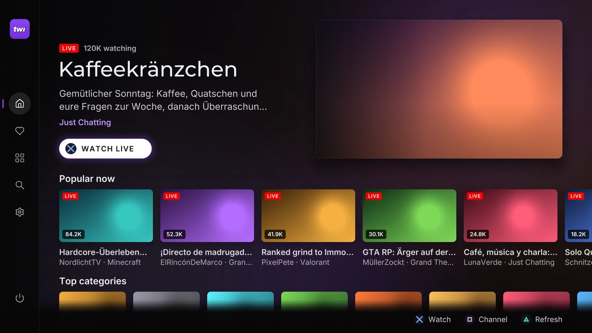
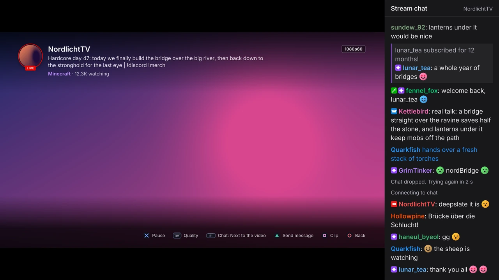
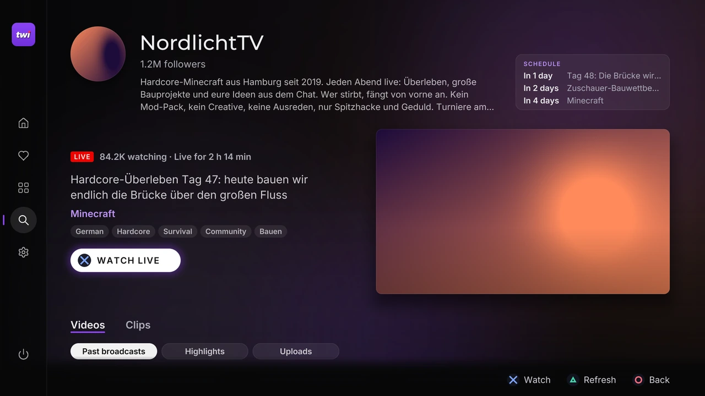
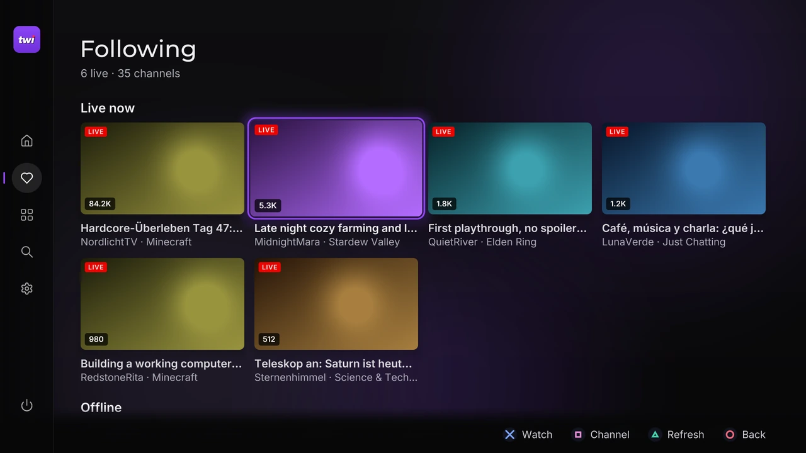
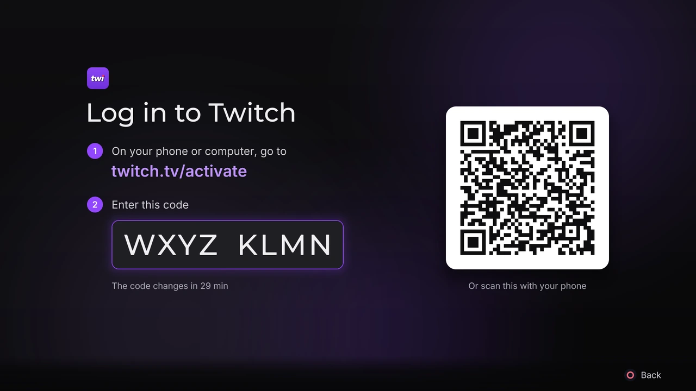

<p align="center">
  
</p>

<p align="center">
  <b>Twitch on a jailbroken PS5: live streams with chat, past broadcasts and clips, played on the console's own video decoder.</b>
</p>

<p align="center">
  <a href="LICENSE"></a>
  <a href="https://github.com/unicxrn/twispero/releases/latest"></a>
  <a href="#requirements"></a>
</p>

<p align="center">
  
  
  
  
</p>

## What it does

- Live streams, past broadcasts, highlights, uploads and clips, decoded by the PS5's own hardware.
- Chat next to the video, over it, or turned off, with emotes, badges and name colours. 7TV, BetterTTV and FrankerFaceZ emotes show up too. Logged in, you can reply to a message.
- Home, Browse, categories, Search (it remembers your last 8 searches) and channel pages with the schedule, videos and clips. Home's top stream plays live, without sound, at the top of the page.
- A stream language filter for Home's popular streams and each category's live streams.
- Any quality the stream offers, from source down to audio only.
- A timeline for videos and clips, and videos pick up where you left off.
- Log in with a QR code to see the channels you follow, get a note when one goes live, chat, and make clips.
- It doesn't need PSN.

## Install

### From a store

Twispero is on [homebrew.page](https://homebrew.page) as PPSA99474. Install it from there or from ProsperoStore.

### By hand

1. Download `PPSA99474.zip` from the [latest release](https://github.com/unicxrn/twispero/releases/latest).
2. Unzip it. You get a folder called `PPSA99474`.
3. Copy that folder into `/data/homebrew/` on the console, for example with an FTP client and etaHEN's FTP server (port 1337 by default).
4. Give ShadowMount+ a few seconds to find it. A Twispero tile shows up next to your games.
5. Start it like any game.

To update, close the app and replace the folder with the new one. Your login and settings are kept in `/data/ps5twitch`, so they stay. To remove the app, delete `/data/homebrew/PPSA99474`, and `/data/ps5twitch` as well if you want your login and settings gone.

### Closing the app

Close it from the PS button menu like any game. The app stops drawing as soon as the PS5 takes over, before the close goes through. In 1.0, closing it like that while a stream played could crash the console; 1.1 fixed that. The side menu (press Left at the start of a row) also has Quit, which stops everything and shows a "safe to close" screen first.

## Requirements

- A jailbroken PS5 running etaHEN with kstuff.
- ShadowMount+ (ShadowMountPlus), which turns a folder in `/data/homebrew` into a tile on the home screen.
- A way to copy files to the console, such as FTP.

It was tested on firmware 13.60. Other firmware may work, but nobody has tried it yet. You don't need a Twitch account to watch or to read chat.

## Logging in



Following, sending chat messages and making clips need a login. Open Following, or Settings > Twitch > Twitch account, and press Cross. The app shows a code and a QR code:

- scan the QR code with your phone, which opens twitch.tv/activate with the code already filled in, or
- go to twitch.tv/activate on any phone or computer and type the code.

Approve the login there, and the app picks it up within a few seconds. It renews itself and keeps working for weeks. To log out, press Cross on the Twitch account row again.

<br clear="right">

## Controls

In the menus:

| Button | What it does |
| --- | --- |
| D-pad | Move around |
| Cross | Open, play or pick |
| Circle | Back |
| Square | Open the channel of the stream or clip you're on |
| Triangle | Reload |
| L1 and R1 | On Browse and a category's Live tab: pick the stream language |
| Left, at the start of a row | Open the side menu: Home, Following, Browse, Search, Settings and Quit |

In the player:

| Button | What it does |
| --- | --- |
| Cross | Play or pause |
| R1 | Chat next to the video, over it, or off |
| R2 | Quality |
| Triangle | Send a chat message (logged in) |
| L1, then Up and Down | Pause chat and pick a message, then L1 again to reply to it (logged in) |
| Square | Clip the last moments of a live stream, then scan the QR code to see it (logged in) |
| Left and Right | Skip 10 seconds in videos and clips; hold to scrub |
| Circle | Back, then Stop to leave the player |

Settings has three pages. Twitch has your account, the default quality, where chat goes, the chat text size, third-party emotes, live notifications and the live preview on Home. Controls & sound has the keyboard (the PS5's own or the app's), navigation sounds and the controller light. System has Clear history, About and Quit.

## What it can't do

- Claim channel points, or follow and unfollow channels. Twitch only allows that in its own apps.
- Play the chat replay of past broadcasts.
- Deal with ads. Live streams are requested the way an embedded player asks for them, which has come back without ads so far. If Twitch does play an ad, the picture can freeze until the stream comes back.
- Draw emoji or Chinese, Japanese and Korean characters. The fonts cover Western and Central European Latin, Greek and Russian Cyrillic, and other characters in names and titles are left out instead of showing as boxes.

## Privacy

- Everything the app keeps stays on the console, in `/data/ps5twitch`: your settings, watch history, recent searches, how far you got in each video, and your login.
- The login is `/data/ps5twitch/auth.json`. It holds the tokens Twitch hands out for the app, never your password, and logging out deletes it. The jailbreak's FTP server has no password, though, so anyone who can reach the console on your network can read that file. Don't leave the console open to a network you don't trust.
- The app talks to Twitch. To show 7TV, BetterTTV and FrankerFaceZ emotes it also sends the channel's ID to those three services; Settings can turn that off.
- The app has no telemetry, analytics or update check.
- With a USB stick plugged in, the app writes a diagnostic log to `/mnt/usb0/evo.log` and serves the same log on your local network, on port 9780, while it runs. The log leaves out your tokens and the messages you send.

## Building from source

Everything builds in a Docker image that carries the PS5 Payload SDK, so the host only needs Docker with the compose plugin. The first build takes a while, because it builds the image and then FFmpeg 7.1.1 from the source in `app/third_party/ffmpeg`.

```bash
git clone https://github.com/unicxrn/twispero
cd twispero/app
cp .env.example .env    # on Linux, uncomment HOST_UID and HOST_GID and set them to `id -u` and `id -g`
docker compose build ps5-dev
docker compose run --rm ps5-dev ./scripts/build-ffmpeg.sh --profile minimal --install
docker compose run --rm ps5-dev ./scripts/release-zip.sh --source-url https://github.com/unicxrn/twispero
```

That builds the app and packs it as `app/output/release/PPSA99474.zip`, the same zip a release ships, and prints its sha256. The unpacked folder is `app/output/app/PPSA99474/`. Copy it to the console yourself, or set `PS5_HOST` in `.env` and run `./scripts/deploy-app.sh`, which uploads it over FTP.

- `./scripts/package-app.sh` builds the folder without the zip, and `./scripts/build-evoplayer.sh` only checks that everything compiles. Started from the host, both run themselves in the container.
- Don't call `make` yourself. The Makefile doesn't list FFmpeg's own dependencies, so the scripts do the linking.
- About shows the commit the app was built from as the build ID, with `-dirty` added when `app/projects/evoplayer` had uncommitted changes.
- The app's name and title ID live in one place, `app/projects/evoplayer/sce_sys/param.json`, and the version in `app/projects/evoplayer/VERSION`. Raise `contentVersion` in param.json by one for every release, or consoles won't see the update.

### The core on a PC

`core/` is the Twitch part: plain C++17 with no PS5 code in it. It builds on Linux with CMake, nlohmann-json and libcurl 8 (with WebSocket support), and comes with a small command-line client:

```bash
cmake -S core -B build
cmake --build build -j
./build/twitch-cli top 10          # what's live right now
./build/twitch-cli chat <channel>  # read a channel's chat
```

[core/README.md](core/README.md) has the rest of its commands.

## How it fits together

- `core/` talks to Twitch's web API for the public data (streams, categories, search, channels, videos, clips, playlists and chat) and to Twitch's official API, Helix, for what needs a login. It never touches the network itself: the app hands it an HTTP client and a WebSocket.
- `app/` is the PS5 app, a fork of [EVO Player](https://github.com/sainsaji/EVO-PLAYER-PS5), which handles the video decoding, audio, UI and packaging. The Twitch glue is in `app/projects/evoplayer/twitch/`, and the screens are `app/projects/evoplayer/core/src/screens/Twitch*` and `app/projects/evoplayer/ui_kit/src/evo_hui_twitch_*`. [app/README.md](app/README.md) has the map.
- `app/third_party/ps5-homebrew-ui` is the UI kit the screens are drawn with.

Twitch's official API doesn't cover video, so the app uses the same web endpoints Twitch's own website uses, like Streamlink and other third-party players do. Twitch can change those without warning. Everything that depends on them is in a few files of `core/src`: `gql.cpp`, `streams.cpp`, `browse.cpp`, `playback.cpp` and `videos.cpp`, plus the ad markers in `hls.cpp`.

## Bugs and ideas

Open an [issue](https://github.com/unicxrn/twispero/issues). For a bug, say which firmware you're on and which version and build About shows.

## Credits and licence

Twispero is free software under the GNU General Public License, version 3 or later. [LICENSE](LICENSE) has the full text.

Thanks to sainsaji for [EVO Player](https://github.com/sainsaji/EVO-PLAYER-PS5), which this app is built on, and to KINGDKAK for [ProsperoPlayer](https://github.com/KINGDKAK/ProsperoPlayer), where EVO started. Thanks to BlackBearReloaded for [ps5-homebrew-ui](https://github.com/blackbearreloaded/ps5-homebrew-ui) and the native app tooling, and to John Törnblom for the [PS5 Payload SDK](https://github.com/ps5-payload-dev/sdk).

The app also uses FFmpeg, dav1d, RmlUi, SDL2, FreeType, OpenSSL, libxml2, nlohmann/json and qrcodegen, the Inter, Montserrat, Lato and DejaVu fonts, and Lucide icons. [NOTICE](NOTICE) lists every part with its licence, and Settings > System > About shows the same credits on the console.

## Disclaimer

Twispero is an unofficial app. It isn't affiliated with or endorsed by Twitch or Sony. Twitch is a trademark of Twitch Interactive, Inc. PlayStation and PS5 are trademarks of Sony Interactive Entertainment Inc.
